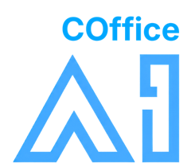
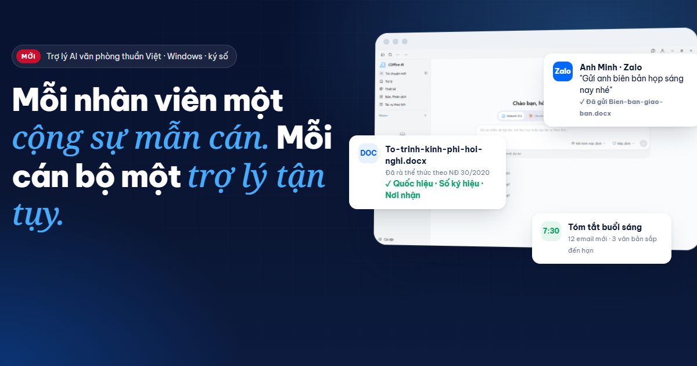
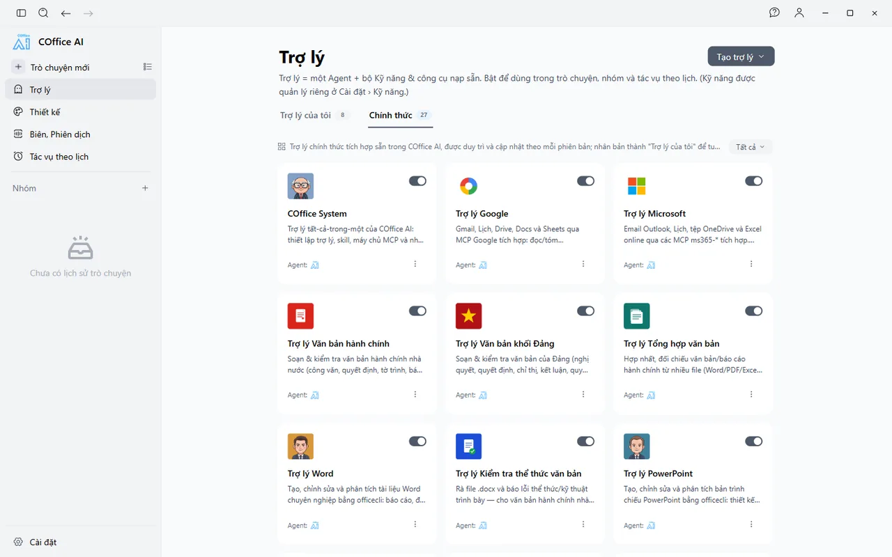
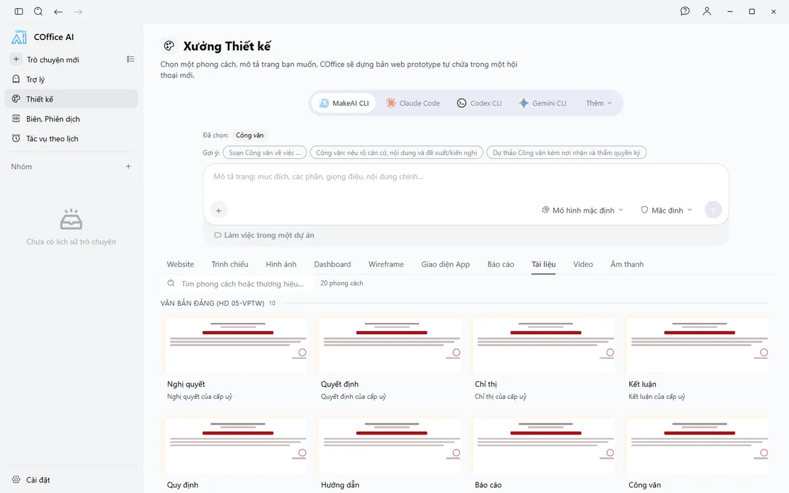
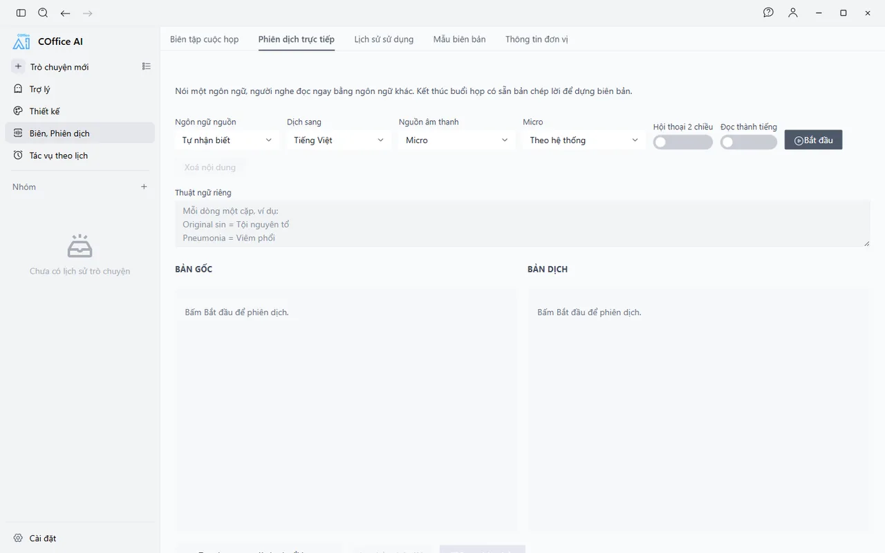

  

<h1 align="center">COffice AI</h1>

  <b>Mỗi nhân viên một cộng sự mẫn cán. Mỗi cán bộ một trợ lý tận tụy.</b> 
  Trợ lý AI văn phòng thuần Việt cho Windows 10/11 — sản phẩm của <a href="https://makeai.vn">MakeAI</a>.

  <a href="https://github.com/duytrinhmakeai/cofficeai.makeai.vn/releases/latest"><b>⬇️ Tải COffice AI cho Windows</b></a>
  &nbsp;·&nbsp;
  <a href="https://cofficeai.makeai.vn/">🌐 Trang giới thiệu</a>
  &nbsp;·&nbsp;
  <a href="https://cofficeai.makeai.vn/#hoi-dap">❓ Hỏi đáp</a>
  &nbsp;·&nbsp;
  <a href="mailto:cofficeai@makeai.vn?subject=%C4%90%C4%83ng%20k%C3%BD%20d%C3%B9ng%20th%E1%BB%AD%20COffice%20AI">✉️ Đăng ký dùng thử</a>

  

COffice AI là đồng nghiệp AI sống ngay trên máy tính của bạn. Thuộc thể thức văn bản Nghị định 30,
làm việc trực tiếp trên Word, Excel, PowerPoint, email và lịch. Nhận việc qua Zalo, tự chạy việc định
kỳ đúng giờ: 24/7, không nghỉ phép, không quên hạn.

> Thông tin đầy đủ, bảng so sánh và tài liệu giới thiệu: **https://cofficeai.makeai.vn/**

## Tải về và cài đặt

1. Vào trang **[Releases](https://github.com/duytrinhmakeai/cofficeai.makeai.vn/releases/latest)**, tải tệp
   `COffice.AI-<phiên bản>-win-x64.exe` (Windows 10/11, 64-bit).
2. Chạy tệp vừa tải và làm theo trình cài đặt.
   - Nếu Windows hiện *"Windows protected your PC"*: bấm **More info → Run anyway**
     (Thông tin thêm → Vẫn chạy).
3. Mở COffice AI, nhập email và mã được gửi về hộp thư — chưa có tài khoản thì COffice tự tạo, không cần
   mật khẩu. Lần sau mở máy vẫn còn đăng nhập. Trợ lý **MakeAI CLI** dùng được ngay, không cần nhập khóa API.
4. Muốn dùng thêm **Codex**, **Gemini CLI**, **GitHub Copilot**, **Grok**, **Claude Code** hay **Muse Code**?
   Chỉ cần nói với trợ lý *"Cài Codex giúp tôi"* — trợ lý tự cài, mở trang đăng nhập và hướng dẫn đăng ký tài
   khoản nếu bạn chưa có. Codex, Gemini CLI, GitHub Copilot và Grok dùng được với tài khoản miễn phí.

Mỗi phiên bản mới đều được đăng tại [Releases](https://github.com/duytrinhmakeai/cofficeai.makeai.vn/releases),
kèm ghi chú thay đổi.

## Vì sao là COffice AI

Không phải ô chat trả lời câu hỏi — **một nhân viên số làm ra sản phẩm thật.**

| | |
| --- | --- |
| **Thuần Việt, thuộc thể thức văn bản** | Soạn và rà văn bản theo Nghị định 30/2020/NĐ-CP và Hướng dẫn 05-HD/VPTW; đã cập nhật mô hình chính quyền địa phương 2 cấp. |
| **Giao file thật** | Word, Excel, PowerPoint, PDF hoàn chỉnh nằm ngay trong thư mục dự án. Không cần cài Microsoft Office. |
| **AI chủ quyền** | Cổng AI, mô hình và kho tri thức có thể đặt ngay trên hạ tầng của đơn vị — dữ liệu không rời khỏi tổ chức. |
| **Càng làm càng giỏi** | Tự đúc kết cách làm thành kỹ năng dùng lại cho cả phòng. Không cần lập trình. |
| **Nối mọi hệ thống** | Microsoft 365, Google, Zalo, phần mềm nội bộ qua MCP — cả web không có API. |
| **VND & người đồng hành** | Một ví MakeAI cho mọi mô hình. Đội ngũ triển khai, đào tạo, may đo trong nước. |

**27** trợ lý chuyên trách dựng sẵn · **100+** kỹ năng chính thức · **150+** phong cách thiết kế ·
**20+** nhà cung cấp mô hình AI · **20** mẫu văn bản NĐ 30 & HD 05 · **24/7** nhận việc qua Zalo & theo lịch.

## Tám năng lực cao cấp

1. **AI chủ quyền** — vận hành hoàn toàn trên hạ tầng riêng; mô hình mã nguồn mở (Qwen, DeepSeek, Llama, Gemma…) chạy trên máy chủ GPU nội bộ.
2. **Linh hoạt** — hơn 20 nhà cung cấp mô hình; tự nhận diện Claude Code, Codex, Gemini CLI và hơn 20 tác tử AI có trên máy.
3. **Tự học** — làm đúng một lần, bấm "Tạo Skill/Rule", lần sau chỉ cần nói "làm như lần trước".
4. **Kết nối** — chuẩn MCP: Microsoft 365, Google Workspace, Office, trình duyệt, tạo ảnh, Canva và hệ thống riêng của đơn vị.
5. **Như người thật** — thao tác trên ứng dụng web (cổng dịch vụ công, phần mềm chuyên ngành); luôn xin phép trước khi nộp, gửi, ký, thanh toán.
6. **Tri thức riêng** — hỏi đáp có trích dẫn trên kho văn bản, quy chế, hồ sơ của đơn vị.
7. **Tự lập trình** — gặp việc khó, tự viết công cụ nhỏ, chạy thử, kiểm tra rồi giao kết quả.
8. **Phòng ban AI** — nhiều trợ lý phối hợp như một tổ công tác cho hồ sơ lớn.

Chi tiết từng năng lực: [cofficeai.makeai.vn/#nang-luc](https://cofficeai.makeai.vn/#nang-luc)

## Giao diện

  
  

  
  

## Dành cho ai

- **Cơ quan nhà nước** — văn thư NĐ 30/2020, văn bản Đảng HD 05, rà thể thức trước khi trình ký, tổng hợp báo cáo cơ sở,
  văn thư đến/đi & đôn đốc, biên bản họp & phiên dịch, kết nối hệ thống quản lý văn bản điều hành.
  → [Xem thêm](https://cofficeai.makeai.vn/#nha-nuoc)
- **Doanh nghiệp** — một "phòng ban số" với 27 trợ lý: thư ký, hành chính – nhân sự, kế toán – tài chính,
  kinh doanh – marketing, quản lý dự án, bộ phận IT. → [Xem thêm](https://cofficeai.makeai.vn/#doanh-nghiep)

## Tài liệu giới thiệu

- [Brochure giới thiệu COffice AI 2026 (PDF)](https://cofficeai.makeai.vn/tai-lieu/COffice-AI-Brochure-2026.pdf)
- [Pitch deck (PDF)](https://cofficeai.makeai.vn/tai-lieu/COffice-AI-Pitch-Deck-2026.pdf) ·
  [Pitch deck (PowerPoint, kèm ghi chú)](https://cofficeai.makeai.vn/tai-lieu/COffice-AI-Pitch-Deck-2026.pptx)
- [So sánh với Claude Cowork, ChatGPT Work, OpenClaw](https://cofficeai.makeai.vn/#so-sanh)

## Yêu cầu hệ thống

- Windows 10 hoặc 11, 64-bit.
- Kết nối Internet khi dùng mô hình AI trên đám mây (hoặc mạng nội bộ khi triển khai AI chủ quyền).
- Tài khoản MakeAI để dùng MakeAI CLI ngay; hoặc khóa API / tài khoản AI sẵn có của bạn.

## Liên hệ

- Trang chủ: **[cofficeai.makeai.vn](https://cofficeai.makeai.vn/)**
- Email: [cofficeai@makeai.vn](mailto:cofficeai@makeai.vn)
- Facebook: [facebook.com/COfficeAI](https://facebook.com/COfficeAI)
- MakeAI: [makeai.vn](https://makeai.vn)
- Tư vấn triển khai cho tổ chức: [gửi yêu cầu](mailto:cofficeai@makeai.vn?subject=T%C6%B0%20v%E1%BA%A5n%20tri%E1%BB%83n%20khai%20COffice%20AI%20cho%20t%E1%BB%95%20ch%E1%BB%A9c)

---

Repo này dùng để **phát hành bản cài đặt** COffice AI. © 2026 MakeAI. COffice AI là sản phẩm của MakeAI.
Tên sản phẩm của bên thứ ba thuộc về chủ sở hữu tương ứng.
